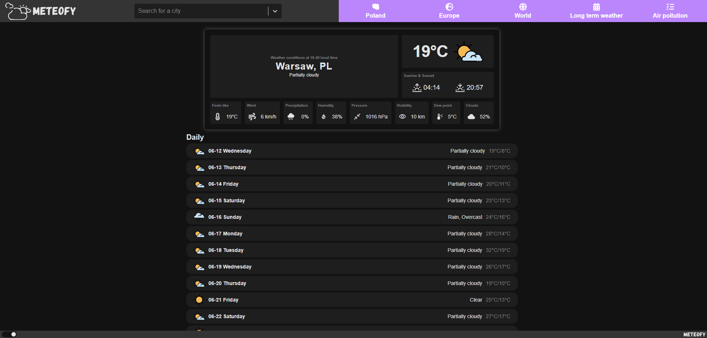
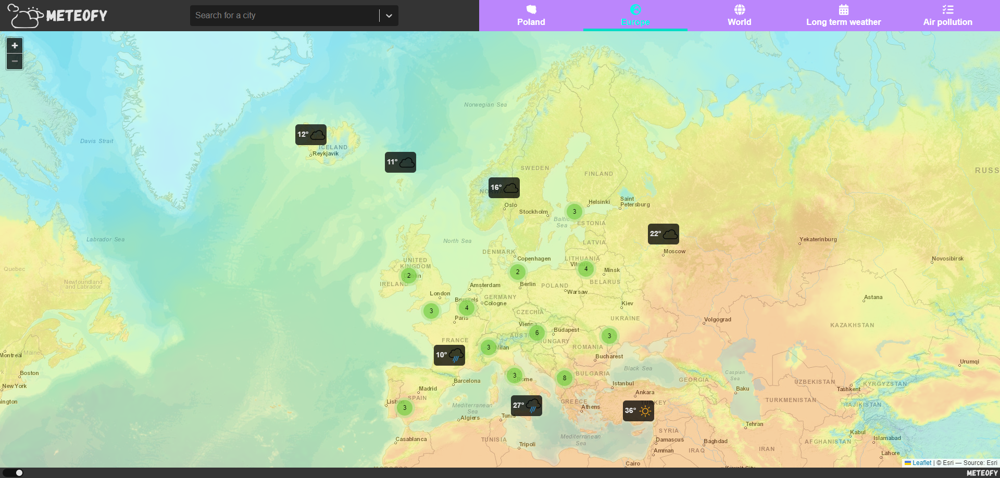
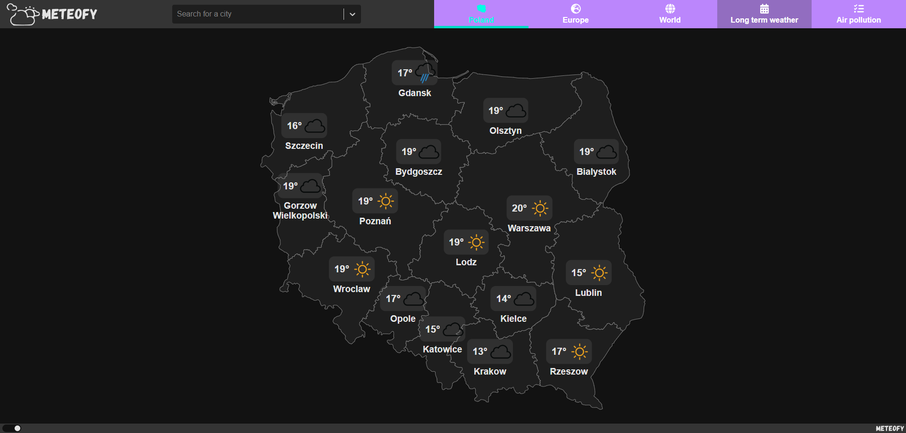
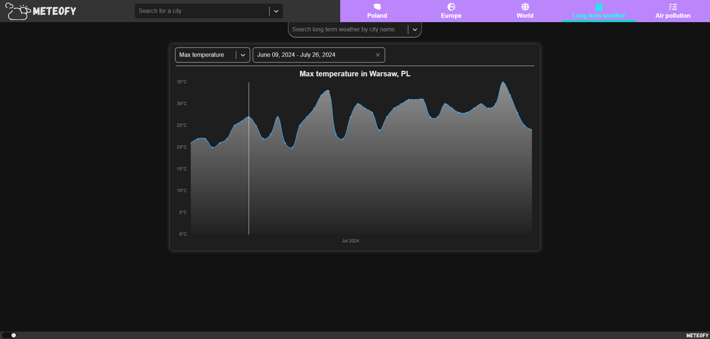

# Meteofy v1.0.0

## Overview

Initial documented release of Meteofy before the UI redesign. This tag freezes the original interface, features, and documentation so the pre-redesign codebase can be browsed on GitHub at any time.

## Features

- Current weather dashboard with a 15-day forecast and city search
- Interactive Poland map with provincial capitals
- Interactive Europe map with country capitals
- Interactive 3D world globe with country capitals
- Long-term weather charts with selectable ranges, metrics, and cities
- Current air pollution and a multi-day forecast with charts
- Light and dark themes
- Fully responsive layout (desktop and mobile)

## Screenshots

### Home

### Europe

### Poland

### World

### Air Pollution

### Long-term Weather

## Notes

This release represents the original UI before the planned v2.0.0 redesign. Do not modify or move the `v1.0.0` tag after publishing; future work should be documented under a new version (for example `v2.0.0`).
